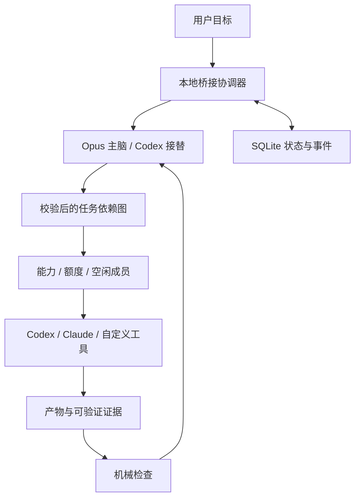

# 通用协作架构与差异

基线：Luok1xi/opus-codex-studio，main@707284eff2757470e2df26a87782cee8a658f770，73 个文件。远端是 schema 2 人工交接框架，仅 Opus/Codex 与一个显式 PowerShell 派工脚本；本机旧输出包后来增加的 DeepSeek/北矿娘资料和 Node 自动化草稿不在远端。此次从真实 Git 克隆扩展，不把私人运行数据或网站路径合入源码。

## 定位

2026-10-14 Owner 明确优先实际工作效率。选用现成能力并验证收益，避免以扩展框架规模作为成果。详细比较、反例与采用决定见 [AUTOMATION_RESEARCH.md](AUTOMATION_RESEARCH.md)。

提供能从现有个人 AI 工具逐步升级的通用本地协作层：成员入口可替换，主脑与机械执行分离，任务和证据可恢复，资源消耗可以度量。编程只是其中一个使用场景；离线演示同时覆盖代码产出和资料报告。

“市场空白”是待验证的产品假设。多代理派工、会话恢复和额度路由已经有现成项目，不能宣称发明这些能力或已经领先市场。需要验证的差异是：在 Windows 和用户已有客户端之间，做到更少人工搬运、更少重复上下文、更可靠的交接，以及可解释的额度决策。

## 模块

| 文件 | 责任 |
|---|---|
| tools/bridge.py | 人或 AI 都能调用的薄命令入口 |
| contracts.py | 区分所有者配置与模型计划；校验依赖和能力；剔除伪造运行状态 |
| store.py | SQLite 事务、幂等请求、增量事件、进程锁和中断记录 |
| routing.py | 优先级、能力匹配、额度缓存与失败冷却 |
| context.py | 固定约束、按依赖取证、内容散列和上下文预算 |
| engine.py | 计划→任务→检查→验收；独立读任务并行、同目录写入互斥 |
| adapters.py | 官方 CLI 与自定义命令；真实额度、原生会话与有界进程生命周期 |

运行时只依赖 Python 标准库，无数据库服务、Docker、WSL、Web UI 框架或付费 API 转发层。旧派工脚本保留，第三方文件继续锁定散列。新增 Git 属性防止 Windows 换行转换破坏这些原件。

## 三轮设计取舍

1. **可靠性先于更多并发。** 幂等提交、单协调器、模型计划不能标记自己已完成、停止进程树。只读步骤或有匹配且完整成功回执的步骤可有界恢复，调用预算不重置；未知写结果进入 needs-reconciliation。额度耗尽只能安全交接已确认可续接的角色/步骤。
2. **减少无效计算。** 机械动作不调用 AI；同类额度探测合并缓存；只传直接依赖证据；上下文超限明确处理；独立只读任务并行；任务预算结束仍收回已运行成员的成果。无修复预算的硬失败不再调用终审；原生思考强度可按成员角色设置，共享额度组不因角色别名而重复探测。
3. **适配真实工作。** 统一任务/回报合同，代码和资料使用同一流程；保留人工入口、自定义能力与自定义适配器；所有称为成功的任务必须经过配置的机械检查和主脑验收。

主脑和成员的“契合度”来自明确输入、共同约束、具体验收标准、可信成果和交接点。无差别互相聊天、无限批评循环、大量重播历史会增加成本，不作为默认策略。主脑需要的是已验证的结论和可继续工作的资料。

## 下一阶段的可检验目标

- 真实 Opus 登录后，验收“Opus 计划→其他成员产出→Opus 复核”；用真实限额或受控故障验证接替。
- 为 DeepSeek 完成已安装入口、权限和余额来源验证；随后接入真实图形界面/浏览器/媒体工具。
- 需要多个并行写者时，增加经过验收的独立目录或 worktree 执行器；不只靠模型声称文件不冲突。
- 收集不同任务的质量评分、完成率、总耗时、真实账单/用量和人工介入次数，再调整分工；当前优先级可解释、可配置，没有未经评估的“自学习最优路由”。

## 外部参考

- [Windows Agent Orchestrator](https://github.com/DrDexter6000/windows-agent-orchestrator)：主脑决策与执行工具分离、Windows 生命周期与证据。
- [ryderderder/orchestrator](https://github.com/ryderderder/orchestrator)：成员会话与额度路由。
- [Hydra](https://github.com/jpdlr/hydra)：管理者派工与可观察工作台。
- [Codex App Server](https://learn.chatgpt.com/docs/app-server)、[Claude headless](https://code.claude.com/docs/en/headless)：官方调用与会话契约。

参考功能边界与协议，没有将这些完整项目打包进来，也未将此前 BUSL 调研包引入本仓库。原仓库许可状态保持不变。
